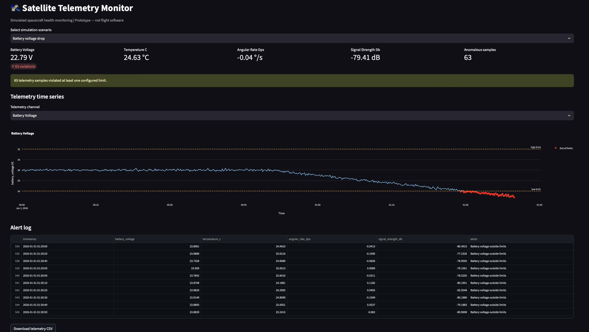

# 🛰️ Satellite Telemetry Monitor

A dashboard that simulates spacecraft health telemetry, injects known faults, and flags out-of-limit readings with a transparent, rule-based detector.

> **Prototype, not real flight software.** All data and procedures are simulated and the limits are pseudo values chosen for this demo. They are not real spacecraft limits.

## Features

- **Simulated telemetry** for four channels: battery voltage, temperature, angular rate, and signal strength (600 samples at 10-second intervals)
- **Six scenarios**: one nominal case and five injected faults, so you can watch the detector respond
- **Rule-based anomaly detection** against configurable limits, with a per-channel violation flag and a readable alert message for each affected sample
- **Interactive time-series chart** (Plotly) with dashed limit lines and red markers on out-of-limit samples for the selected channel
- **Summary cards** showing the latest reading per channel plus a violation count, so a fault that has already passed (like a single-sample spike) is still visible
- **Alert log** table of every anomalous sample, with a **CSV download** of the full dataset
- **Deterministic output**: a fixed random seed means the same scenario always produces the same data
- **Standard operating procedures (SOPs)** for each channel, written as validated Markdown files (see [Operations](#operations))
- **Guided incident response**: work through the matching SOP step by step, with every action time-stamped, then export the log as CSV and a Markdown incident report
- **Automated tests** for the generator, the detector, and the app itself



## Scenarios

| Scenario | What happens (second half of the run) |
| --- | --- |
| Normal | All channels stay within limits |
| Battery voltage drop | Voltage ramps down by 5 V |
| Thermal rise | Temperature ramps up by 45 °C |
| Excessive angular rate | Angular rate jumps by +3.5 °/s |
| Weak signal | Signal strength ramps down by 40 dB |
| Sensor spike | One temperature sample reads 95 °C |

## Detection limits

These are demo values defined in `detector.py`. A reading exactly on a bound counts as in range.

| Channel | Low | High |
| --- | --- | --- |
| Battery voltage (V) | 24.0 | 32.0 |
| Temperature (°C) | -10.0 | 60.0 |
| Angular rate (°/s) | -2.0 | 2.0 |
| Signal strength (dB) | -110.0 | -50.0 |

## Getting started

### Requirements

- Python 3.10 or newer
- The packages in `requirements.txt` (numpy, pandas, plotly, streamlit 1.50 or newer, pytest)

### Install

```bash
git clone <https://github.com/shrutix/Satellite-Telemetry.git>
cd satellite-telemetry

python3 -m venv .venv
source .venv/bin/activate        # Windows shell: .venv\Scripts\Activate.ps1

python -m pip install --upgrade pip
python -m pip install -r requirements.txt
```

### Run the app

```bash
python -m streamlit run app.py
```

Streamlit prints a local URL (usually <http://localhost:8501>). Open it, pick a scenario, then choose a channel to inspect. To try the guided response, pick a fault scenario such as "Thermal rise" and scroll to the **Guided response** section.

### Run the tests

```bash
python -m pytest
```

The detector, telemetry, SOP, and incident-log tests run in about a second. The app and guided-response tests launch the streamlit script, so the full suite takes longer. To run only the fast tests:

```bash
python -m pytest tests/test_detector.py tests/test_telemetry.py
```

## How detection works

`detect_anomalies(df, limits=None)` takes a DataFrame of telemetry and returns a copy with three kinds of added columns:

- `<channel>_violation`: boolean, true where that channel is outside its limits
- `alerts`: the messages for that sample joined with `"; "` (empty if none)
- `is_anomaly`: boolean, true if any channel is out of limits

You can pass your own limits to override the defaults. NaN values are not flagged, and invalid limits (low greater than high) raise a `ValueError`.

```python
from telemetry import generate_telemetry
from detector import detect_anomalies

df = detect_anomalies(generate_telemetry("Thermal rise"))
print(df.loc[df["is_anomaly"], ["timestamp", "temperature_c", "alerts"]].head())
```

## Operations

Detecting a fault is only half the job. In real operations, an operator follows a written procedure so that every anomaly is handled the same safe way, and records what they did. This project models that workflow.

### Standard operating procedures

An SOP (standard operating procedure) is a step-by-step checklist for one situation. Each lives in `procedures/` as a Markdown file with a short metadata header:

```markdown
---
id: SOP-002
title: Temperature Outside Limits (Thermal Excursion)
channel: temperature_c
severity: High
escalate_to: Thermal subsystem engineer on call
---
 
## Prerequisites
- Telemetry display is live and the alert is visible in the alert log
 
## Steps
1. Record the alert time, the temperature reading, and the direction of the violation.
2. Check the next two samples to see whether the reading is real...
 
## Exit criteria
- Temperature has stayed inside limits for 10 continuous minutes, or
- The escalation contact has formally taken over the incident
```

Four included procedures cover each monitored channel:

| SOP | Channel | Severity | Escalate to | When to escalate |
| --- | --- | --- | --- | --- |
| SOP-001 | Battery voltage | High | Power subsystem engineer | Falling steadily, or 3+ consecutive samples out of limits |
| SOP-002 | Temperature | High | Thermal subsystem engineer | 3+ consecutive samples, or immediately if still moving away from the limit |
| SOP-003 | Angular rate | Critical | Attitude control (AOCS) engineer | 2+ consecutive samples, or the rate is growing |
| SOP-004 | Signal strength | High | Communications and ground systems engineer | 3+ consecutive samples, or ground-side checks are clean |

Each procedure first checks whether the alert is real (a one-sample spike is treated as a possible sensor glitch), then establishes the trend, looks at the other channels for related changes, escalates on a defined trigger, and ends with measurable exit criteria.

`sop.py` loads these files and **validates** them: required fields, an `SOP-001`-style id, a known channel and severity, steps numbered 1, 2, 3 with no gaps, and non-empty exit criteria. A malformed procedure fails with a clear message instead of silently misbehaving, and a test requires that every channel has an SOP.

### Guided response

When a channel goes out of limits, the **Guided response** section of the dashboard offers the matching procedure:

1. Choose the procedure, enter your name, and start the incident. The first out-of-limit sample is recorded as the trigger.
2. Work through the steps in order. Mark each one done, skip it with a written reason, or log a note.
3. Escalate to the named contact when the procedure says to.
4. Close the incident as `resolved` or `handed_over`.
The log enforces the discipline an SOP is meant to create:

- Steps are handled strictly in order, and each only once
- A step can be skipped only with a written reason
- An incident closes as `resolved` only after every step is handled, and as `handed_over` only after it has been escalated
- Nothing can be added once the incident is closed
Every action is stored with a UTC timestamp, the operator's name, the step, and any note. You can download the log as a **CSV** (`timestamp, incident, operator, event, step, detail, note`) or as a **Markdown incident report** with a readable timeline, suitable as a post-incident write-up.

### Writing a new procedure

1. Copy `procedures/_TEMPLATE.md` to a new file, for example `procedures/my_procedure.md`. Files starting with an underscore are ignored by the loader.
2. Fill in a unique `id`, a valid `channel` and `severity`, the escalation contact, numbered steps, and exit criteria.
3. Run `python -m pytest tests/test_sop.py tests/test_incident.py`. The tests validate the new file and confirm it can be run from start to finish.

> The procedures, thresholds, and escalation contacts are pseudo content written for this simulation. Real procedures depend on a specific spacecraft's design and operations.

## License

This project is released under the [MIT License](LICENSE).